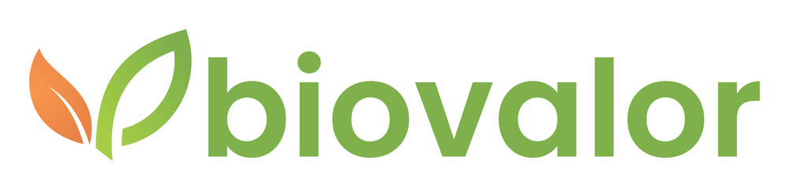
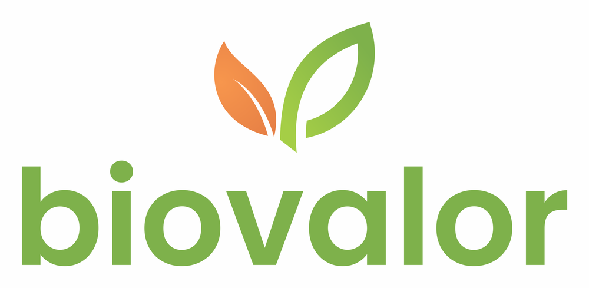
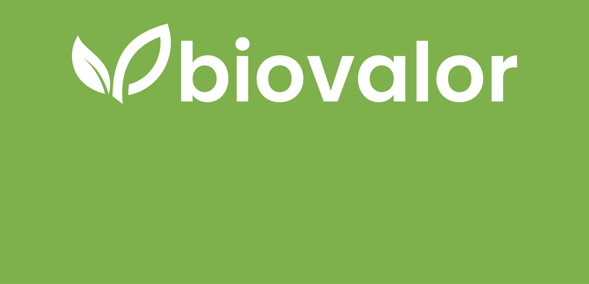
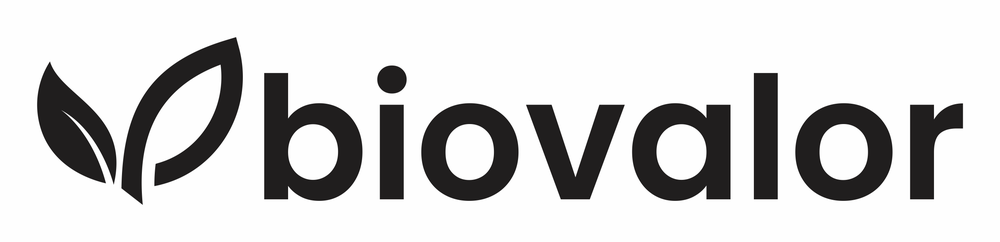
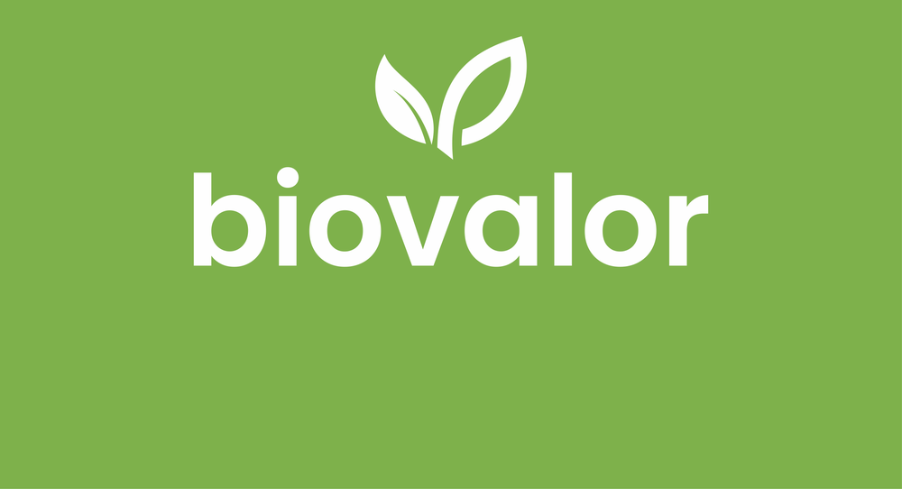
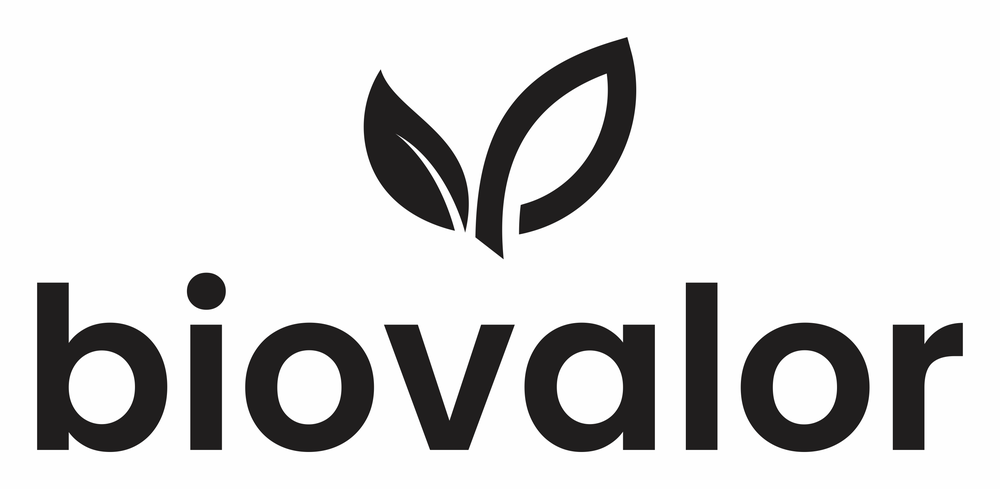

# Requisitos específicos - Biovalor

Este documento reúne as necessidades particulares levantadas junto à empresa parceira, além do escopo base do MVP de Controle de Resíduos.

## 🎨 Identidade visual

| Campo | Informação |
|---|---|
| **Logotipo (horizontal)** |  |
| **Logotipo (vertical)** |  |
| **Ícone** |  |
| **Cor primária** | `#A5CE46` (verde) |
| **Cor secundária** | `#FF9933` (laranja) |
| **Tipografia** | Poppins (SemiBold nos títulos) |

### Paleta (Manual de Marca)

| Cor | HEX | Observação |
|---|---|---|
| Verde | `#A5CE46` | Cor padrão do manual (CMYK 56 8 99 4). |
| Laranja | `#FF9933` | Cor padrão do manual (CMYK 4 60 88 2). |
| Verde do logotipo | `#7EB14B` | Verde predominante nos arquivos do logotipo (texto e fundo da versão branca). Medido nas imagens, não consta no manual. |
| Branco | `#FFFFFF` | Fundo preferencial da marca. |
| Preto | `#201E1E` | Usado na versão monocromática do logotipo. Aproximado a partir das imagens. |

> O manual lista como cores padrão o verde `#A5CE46` e o laranja `#FF9933`, mas o verde que predomina nos arquivos do logotipo é `#7EB14B`. Para botões e textos sobre fundo branco, `#7EB14B` tem melhor contraste que `#A5CE46`. Recomenda-se confirmar com a empresa qual verde usar como principal na interface.

### Versões do logotipo

| Versão | Prévia |
|---|---|
| **Horizontal branco (fundos escuros ou coloridos)** |  |
| **Horizontal preto** |  |
| **Vertical branco** |  |
| **Vertical preto** |  |
| **Ícone branco** |  |
| **Ícone preto** |  |

### Regras da marca

- **Uso principal (horizontal):** materiais digitais e qualquer material de marketing oficial que peça boa legibilidade.
- **Uso secundário (vertical e ícone):** imagem de perfil, grafismos, animações, marca d'água e materiais de espaço reduzido.
- **Versão positiva:** dar preferência ao logotipo nas cores institucionais sobre fundo branco. Quando não for possível, usar as versões monocromáticas.
- **Usos indevidos:** a marca não deve ser alterada em cores, diagramação ou proporções. Não redesenhar o logotipo.
- **Grid de construção:** respeitar o espaçamento do logotipo (módulos descritos na página 5 do manual).

## 🌐 Site / domínio e canais

| Campo | Informação |
|---|---|
| **Instagram** | @biovalor |
| **Site institucional da empresa** | A definir (não informado pela empresa) |

## 📚 Material de referência

| Campo | Informação |
|---|---|
| **Manual de Marca** | [Manual de Marca Biovalor (PDF)](docs/manual-de-marca-biovalor.pdf), versão 1.0 de março de 2024, enviado pela empresa |

## 📝 Observações adicionais

- A paleta de cores, a tipografia e o logotipo devem ser aplicados na interface, deixando o visual alinhado à identidade da empresa.
- **Palavras norteadoras da marca:** ecossistema, sustentabilidade e confiança. A interface e os textos devem refletir esse tom.
- Os arquivos de logotipo recebidos são PNG sem transparência: as versões coloridas e pretas têm fundo branco, e as versões brancas têm fundo verde. Se possível, solicitar versões com fundo transparente ou os arquivos vetoriais (SVG).
- **Pendente:** as necessidades funcionais específicas da Biovalor ainda não foram levantadas com a empresa. Esta seção será completada assim que forem recebidas.

## 🧩 Funcionalidades específicas

### Requisito 1 - Aplicação da identidade visual

**Descrição:** Aplicar o logotipo oficial, a paleta de cores (verde e laranja) e a fonte Poppins em toda a interface, respeitando as regras de uso da marca descritas neste documento e mantendo contraste adequado entre texto e fundo.

**Prioridade:** ALTA

**Status:** PENDENTE
